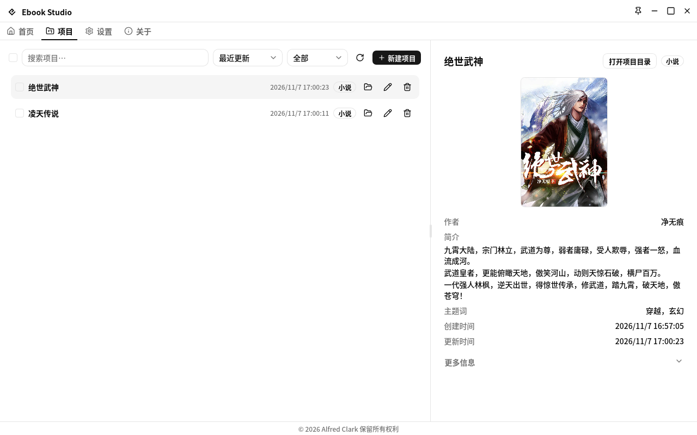

简体中文 | [English](docs/README_en.md)

# Ebook Studio

电子书编辑器桌面应用。创建小说与漫画项目，按步骤编辑，导出标准 EPUB 3.3；漫画还可导出单个 PDF 或原图。

## 界面预览




## 功能

- **项目管理**——新建 / 改名 / 删除小说与漫画项目，搜索 / 筛选 / 排序，按最后活跃时间排列。
- **工作台首页**——继续工作（最近优先）、每个项目的管线阶段（素材 → 解析 → 构建 → 打包），一点即回到上次停下的地方。
- **小说管线**——元数据 → 文件（导入 + 解析）→ 编辑 → 构建 → 打包 → 导出，六步走完并带校验，产出标准 EPUB。
- **漫画管线**——导入图片目录、话 / 页排序、格式转换、图片压缩（等比缩放 + 灰度），构建定版式 EPUB；可按 `content.json` 页序导出单个 PDF、原图文件夹或 ZIP。
- **图片工具**——格式转换（JPEG / PNG / WebP，质量 + 无损 + PNG 级别）与图片压缩（25–100% 等比缩放 + 灰度 + 按源格式重编码），事务性两阶段 + 进度推送。
- **标准 EPUB 3.3**——小说为流式排版，漫画为定版式固定布局；支持封面；含 WebP 时打包给出警告。
- **桌面外壳**——系统托盘、开机自启、窗口状态恢复、单实例 + 深链、显示应用全局快捷键、自动更新。
- **双语界面**——English / 简体中文，持久化在后端配置；11 套配色主题、明暗模式、三种布局。

## 技术选型

| 分层   | 选型                                                                                         |
| ------ | -------------------------------------------------------------------------------------------- |
| 外壳   | Tauri v2 + Rust（`edition 2024`，工具链 `1.99.1`）                                           |
| 界面   | SvelteKit 2 + Svelte 5（SPA，`adapter-static`）、Tailwind CSS v4、shadcn-svelte、Lucide 图标 |
| 契约   | tauri-specta（`#[tauri::command]` + `#[specta::specta]`，生成物 `bindings.ts`）              |
| 国际化 | Paraglide（前端）+ rust-i18n（后端，`fallback = "en"`）                                      |
| 质量   | vitest + `cargo test`、ESLint / Prettier / clippy、svelte-check、epubveri EPUB 校验          |
| 包管理 | pnpm（`packageManager` 锁定，Node `>= 24`），`pnpm-lock.yaml` + `Cargo.lock` 均提交          |

## 快速开始

```bash
pnpm install --frozen-lockfile   # 按锁文件安装
pnpm tauri:dev                   # 完整桌面联调（Vite :1420 + Tauri 窗口）
pnpm dev                         # 仅前端（Tauri 命令打桩降级）

pnpm format                      # 每次改完先自动修复两端
pnpm validate                    # 测试 + 检查 + 校验，全绿再提交
pnpm build                       # 仅构建前端产物
pnpm tauri:build:local           # 打桌面包（不打包安装程序）
```

Rust 工具链由 `rust-toolchain.toml` 锁定，rustup 会自动采用。

## 页面一览

| 路由            | 说明                                                               |
| --------------- | ------------------------------------------------------------------ |
| `/`             | 工作台首页：最近项目（含管线阶段）+ 快捷新建                       |
| `/projects`     | 项目列表 / 详情，搜索 / 筛选 / 排序，新建 / 改名 / 删除            |
| `/settings`     | 通用 + 外观 + 编辑器排版 + 快捷键 + 重置                           |
| `/about`        | 应用 / 项目 / 平台信息、诊断、更新                                 |
| `/(projects)/…` | 单项目六步骤：`metadata / files / edit / build / package / export` |

## 目录结构

```text
src/          SvelteKit 单页应用：routes/ · components/（common · layout · shadcn-svelte）
              · libs/（commands · i18n · navigation · hooks · utils）· tests/
src-tauri/    Rust：commands/（薄封装）· features/（按类型分的业务）
              · cores/（通用能力）· plugins/ · templates/（EPUB33-NOVEL / EPUB33-COMIC）
docs/         ARCHITECTURE.md（结构与不变量）· WORKFLOW.md（命令与验证）
```

完整目录树与分层规则见 `docs/ARCHITECTURE.md`，命令与验证流程见 `docs/WORKFLOW.md`，常驻规则见 `AGENTS.md`（自动加载）。

## 发版

三处版本号联动（`package.json` + `src-tauri/tauri.conf.json` + `src-tauri/Cargo.toml`）：

```bash
pnpm release      # bumpp：一次提交联动升级三处
# 打与 tauri.conf.json 一致的 vX.Y.Z 标签 → release.yml 自动打包安装程序
pnpm changelog    # git-cliff 按 Conventional Commits 生成日志
```

CI（`.github/workflows/ci.yml`）卡格式、检查、测试、绑定同步与构建。

## 许可证

AGPL-3.0-only，见 [LICENSE](LICENSE)。
