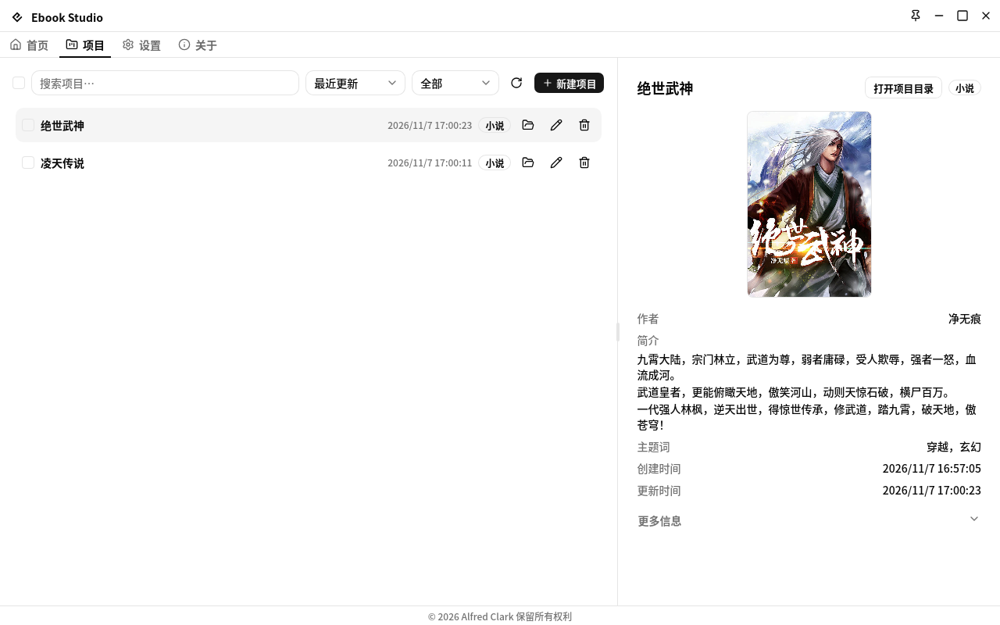

[简体中文](../README.md) | English

# Ebook Studio

Ebook editor desktop application. Create novel and comic projects, edit them step by step, and export standard EPUB 3.3 ebooks.

## Screenshots




## Features

- **Project management** — create / rename / delete novel and comic projects, search / filter / sort, recently-active ordering.
- **Workbench homepage** — continue working (most recent first), per-project pipeline stages (source → parsed → built → packaged), and a shortcut to jump back to where you left off.
- **Novel pipeline** — metadata → files (import + parse) → edit → build → package → export, six steps with validation and standard EPUB output.
- **Comic pipeline** — same six steps for image books: import image folders, reorder episodes and pages, convert formats, compress images (scale + grayscale), and build fixed-layout EPUB.
- **Image tools** — format conversion (JPEG / PNG / WebP, quality + lossless + PNG level) and compression (proportional scaling 25–100%, grayscale, per-format re-encode), transactional with progress.
- **Standard EPUB 3.3** — reflowable text for novels, pre-paginated fixed layout for comics; cover image support; WebP usage warns on packaging.
- **Desktop shell** — system tray, autostart, window-state restore, single instance + deep-link, global shortcut to show the app, auto-updater.
- **Bilingual UI** — English / 简体中文, persisted in backend config; 11 color themes, light / dark mode, three layouts.

## Tech stack

| Layer    | Choice                                                                                       |
| -------- | -------------------------------------------------------------------------------------------- |
| Shell    | Tauri v2 + Rust (`edition 2024`, toolchain `1.99.1`)                                         |
| UI       | SvelteKit 2 + Svelte 5 (SPA, `adapter-static`), Tailwind CSS v4, shadcn-svelte, Lucide icons |
| Contract | tauri-specta (`#[tauri::command]` + `#[specta::specta]`, generated `bindings.ts`)            |
| i18n     | Paraglide (frontend) + rust-i18n (backend, `fallback = "en"`)                                |
| Quality  | vitest + `cargo test`, ESLint / Prettier / clippy, svelte-check, epubveri EPUB validation    |
| Package  | pnpm (`packageManager` pinned, Node `>= 24`), `pnpm-lock.yaml` + `Cargo.lock` both committed |

## Quickstart

```bash
pnpm install --frozen-lockfile   # install exactly what's locked
pnpm tauri:dev                   # full desktop dev (Vite :1420 + Tauri window)
pnpm dev                         # frontend only (Tauri commands stubbed)

pnpm format                      # fix both ends before every change lands
pnpm validate                    # tests + lint + check, all green before commit
pnpm build                       # frontend bundle only
pnpm tauri:build:local           # desktop bundle without packaging
```

Rust toolchain comes from `rust-toolchain.toml` (rustup picks it up automatically).

## Pages

| Route           | What it does                                                                |
| --------------- | --------------------------------------------------------------------------- |
| `/`             | Workbench homepage: recent projects with pipeline stages, quick create      |
| `/projects`     | Project list / detail, search / filter / sort, create / rename / delete     |
| `/settings`     | General + appearance + editor typography + shortcuts + reset                |
| `/about`        | App / project / platform info, diagnostics, updater                         |
| `/(projects)/…` | Per-project six steps: `metadata / files / edit / build / package / export` |

## Structure

```text
src/          SvelteKit SPA: routes/ · components/ (common · layout · shadcn-svelte)
              · libs/ (commands · i18n · navigation · hooks · utils) · tests/
src-tauri/    Rust: commands/ (thin wrappers) · features/ (business per type)
              · cores/ (shared) · plugins/ · templates/ (EPUB33-NOVEL / EPUB33-COMIC)
docs/         ARCHITECTURE.md (structure + invariants) · WORKFLOW.md (commands + QA)
```

See `docs/ARCHITECTURE.md` for the full tree and layering rules, `docs/WORKFLOW.md` for commands and the verification matrix, and `AGENTS.md` for the standing rules (loaded automatically).

## Release

Versions ride together in `package.json` + `src-tauri/tauri.conf.json` + `src-tauri/Cargo.toml`:

```bash
pnpm release      # bumpp: bump the three files in one commit
# tag vX.Y.Z matching tauri.conf.json → release.yml builds installers
pnpm changelog    # git-cliff changelog from Conventional Commits
```

CI (`.github/workflows/ci.yml`) gates on format, lint, tests, binding sync, and build.

## License

AGPL-3.0-only. See [LICENSE](LICENSE).
